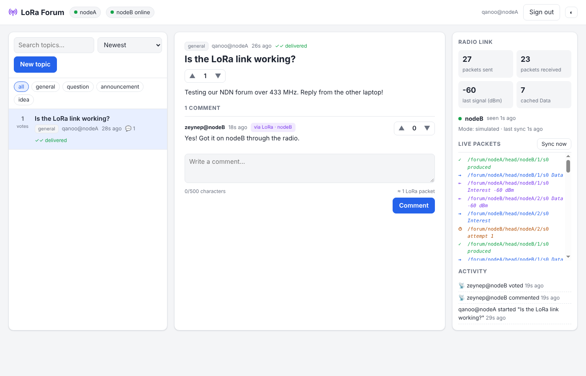
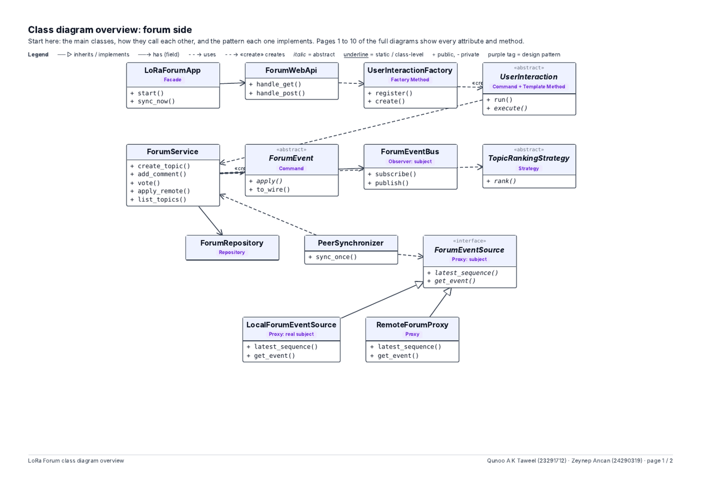
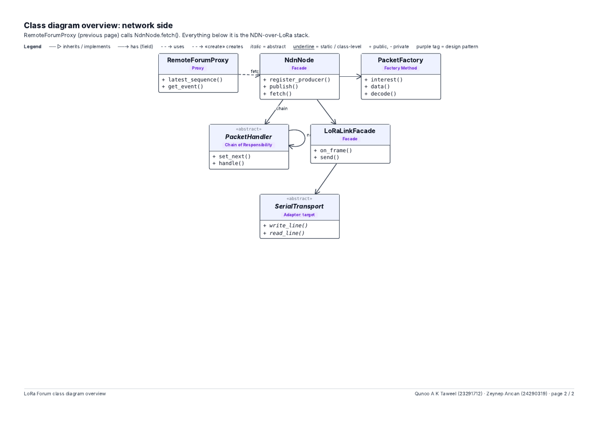

# LoRa NDN Forum

**Authors:** Qunoo A K Taweel (23291712) · Zeynep Arıcan (24290319)

A university assignment: two laptops run the same small forum (topics, comments, votes, accounts), and they keep each other in sync **over LoRa radio instead of the internet**. The data travels using **NDN (Named Data Networking)**: a laptop asks for data by name (an *Interest*, like `/forum/qanoo/head/...`) and the other side answers with a *Data* packet.

Each laptop has a **Raspberry Pi Pico 2 W** with an **XL1278 (SX1278) 433 MHz LoRa module** plugged into USB. The Pico is just a bridge, like an antenna attached to the computer: it passes frames between USB serial and the radio.

```
Browser ⇄ forum app (Python) ⇄ USB ⇄ Pico 2 W ⇄ LoRa 433 MHz ⇄ Pico 2 W ⇄ USB ⇄ forum app ⇄ Browser
```



## What's in here

| Path | What it is |
|---|---|
| `pico/sx1278.py` | Small MicroPython driver for the SX1278 radio |
| `pico/hello.py` | Radio test: two boards send "hello" to each other |
| `pico/bridge_main.py` | USB ⇄ LoRa bridge, saved on the Pico as `main.py` |
| `pico/STEP1.md` | Detailed wiring and first radio test |
| `laptop/` | The forum app: NDN layer (`ndn/`), forum logic (`forum/`), web page (`web/`), tests |
| `STEP2.md` | Detailed guide to running the forum over the radios, plus troubleshooting |
| `PATTERNS.md` | Design patterns and SOLID principles: which class applies which one, and why |
| `diagrams/` | Class diagrams: a 2-page overview and the full 10-page set (PDF and HTML), plus `make_diagrams.py`, which generates them from the source code |

## Hardware (per laptop)

- 1 × Raspberry Pi Pico 2 W
- 1 × XL1278 / SX1278 433 MHz LoRa module with antenna
- Breadboard, jumper wires, USB cable

### Wiring

| LoRa module | Pico pin |
|---|---|
| VCC (3.3 V) | 3V3(OUT), pin 36 |
| GND | GND, pin 23 (or pin 38, any GND works) |
| SCK | GP18, pin 24 |
| MOSI | GP19, pin 25 |
| MISO | GP16, pin 21 |
| NSS | GP17, pin 22 |
| RST | GP20, pin 26 |
| DIO0 | GP21, pin 27 |

Never connect VCC to VBUS or VSYS (5 V); it will damage the module. Keep the antenna attached whenever the board has power. See [`pico/STEP1.md`](pico/STEP1.md) for a breadboard walkthrough.

## Setup

### 1. Flash MicroPython on each Pico

1. Download the newest `.uf2` for **RPI_PICO2_W** from https://micropython.org/download/RPI_PICO2_W/.
2. Hold **BOOTSEL**, plug the Pico in, let go. A drive called `RP2350` appears.
3. Drag the `.uf2` onto it. It reboots by itself.

### 2. Put the bridge on each Pico

1. Install **Thonny** from https://thonny.org and pick **Tools > Options > Interpreter > MicroPython (Raspberry Pi Pico)**.
2. Open `pico/sx1278.py` and **File > Save as… > Raspberry Pi Pico** as `sx1278.py`.
3. (Optional) Save `pico/hello.py` the same way and run it on both boards to check the radios hear each other.
4. Open `pico/bridge_main.py` and save it on the Pico as **`main.py`**. Press Stop; the shell prints `READY`.
5. **Quit Thonny**, because it keeps the USB port busy.

### 3. Run the forum on the laptops

Needs Python 3.8+. Nothing else on macOS/Linux; on Windows run `py -m pip install pyserial` once.

```bash
git clone <this repo>
cd pico-lora-ndn-forum/laptop
```

**Try it without hardware first** (two simulated forums with a simulated radio that drops 10% of packets):

```bash
python3 app.py --sim
```
Open http://127.0.0.1:8001 and http://127.0.0.1:8002.

**The real thing**, one command per laptop (names must match each other):

```bash
python3 app.py --name qanoo  --peer zeynep    # laptop 1
python3 app.py --name zeynep --peer qanoo    # laptop 2
```
Open http://127.0.0.1:8000 on each. If the Pico isn't found automatically, add `--port /dev/cu.usbmodem101` (macOS) or `--port COM3` (Windows).

Run the tests: `python3 -m unittest discover -s tests -v` (from `laptop/`).

## Demo script

1. Put the two laptops a few metres apart and **turn Wi‑Fi off** on both, so only the radios connect them.
2. Start the app on both. The pill at the top turns green ("zeynep online") when the peer answers over LoRa.
3. Create an account and post a topic on laptop A. On laptop B it appears within seconds with a purple **via LoRa** tag. Point at the → Interest and ← Data lines in the **Live packets** panel.
4. Comment and vote on B. They arrive on A, and A's post changes from ✓ waiting to **✓✓ delivered**.
5. Unplug one Pico: the pill turns red. Post on the other side, plug it back in and restart the app: everything catches up, because NDN asks for data by name, not by connection.

## Design

The code is organised around the SOLID principles and these patterns: Facade, Factory Method, Proxy, Chain of Responsibility, Observer, Command, Adapter, Repository, Strategy and Template Method. [`PATTERNS.md`](PATTERNS.md) lists where each one is applied and why.

### Class diagrams

The diagrams are generated from the code by [`diagrams/make_diagrams.py`](diagrams/make_diagrams.py), so they match it exactly.

- **[Overview](diagrams/class-diagram-overview.pdf)** (2 pages): the main classes, how they connect, and the pattern each one implements. Read this first to get the big picture.
- **[Full class diagrams](diagrams/class-diagrams.pdf)** (10 pages): every class with all attributes and methods, one page per subsystem. Each page is titled with the patterns it shows.

**Overview, forum side.** The browser talks to `ForumWebApi`, which uses `UserInteractionFactory` to create a command for each user action. `ForumService` applies the forum rules, stores data through `ForumRepository`, and announces changes on `ForumEventBus`. `PeerSynchronizer` pulls new events from the other laptop through `RemoteForumProxy`.



**Overview, network side.** `RemoteForumProxy` asks `NdnNode` for named data. `NdnNode` builds packets with `PacketFactory`, passes incoming packets along a chain of `PacketHandler`s, and sends frames through `LoRaLinkFacade` and `SerialTransport` to the Pico.



| Full diagram page | Subsystem | Patterns |
|---|---|---|
| 1 | NDN packets | Factory Method |
| 2 | LoRa link and serial adapters | Facade, Adapter, Factory Method |
| 3 | NDN node | Facade, Observer, Strategy |
| 4 | Incoming packets | Chain of Responsibility, Template Method |
| 5 | Forum rules | Command, Factory Method, Observer |
| 6 | Sorting topics | Strategy |
| 7 | Storage | Repository, Interface Segregation, Dependency Inversion |
| 8 | Syncing with the other laptop | Proxy |
| 9 | User actions and web API | Factory Method, Command |
| 10 | Composition root | Facade, Dependency Injection |
